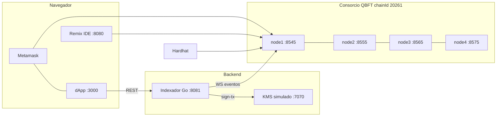

# Taller Blockchain de Consorcio (Hyperledger Besu · QBFT · Solidity · Go)

Red de 4 validadores en Docker, contratos con Hardhat/Remix, KMS simulado, microservicio indexador en Go y una dApp con Metamask. Pensado para quien viene del desarrollo web tradicional.

> **Proyecto Voltera (Entrega 4):** este repo también aloja la facturación verificable del curso ARTI-4208. Empieza por [docs/voltera/README.md](docs/voltera/README.md). 



## Prerrequisitos
Docker Desktop, Node 20+, Go 1.26+ (solo si compilas fuera de Docker), Metamask en el navegador.

## Arranque rápido (PowerShell)
```powershell
.\taller.ps1 up                 # genera genesis+llaves y levanta los 4 nodos
.\taller.ps1 status             # bloque/peers/validadores (espera ~20 s a que haya bloques)
.\taller.ps1 deploy             # compila y despliega EventRegistry + SimpleToken
.\taller.ps1 up -Tools          # + Remix, KMS, indexador, dApp
```
| Servicio | URL |
|---|---|
| RPC node1..4 | http://localhost:8545 / 8555 / 8565 / 8575 |
| Remix IDE | http://localhost:8080 |
| dApp | http://localhost:3000 |
| Indexador (REST) | http://localhost:8081/events |
| KMS simulado | http://localhost:7070/keys |
| Grafana / Prometheus (`-Monitoring`) | http://localhost:3001 / :9090 |

Cuenta de pruebas prefinanciada (llave **pública y solo de prueba**): `0xFE3B…Bd73`, privada en `.env`. Para Metamask: *Importar cuenta* con esa llave.

Reiniciar de cero: `.\taller.ps1 reset`. Cambiar consenso: `.\taller.ps1 reset; .\taller.ps1 up -Consensus ibft2`.

## Guía (léela en orden) — `docs/taller/`
| # | Tema | Cubre |
|---|---|---|
| 00 | Web2 vs Web3 | entender todo: nodo, bloque, tx, gas, cuenta, DApp |
| 01 | Consenso | PoW, PoS, PoA/Clique, IBFT2, QBFT |
| 02 | Levantar la red | JSON-RPC con curl |
| 03 | Criptografía | hash, claves asimétricas, firmas |
| 04 | Billeteras, KMS y Metamask | HSM/KMS simulado |
| 05 | Remix | editor tipo Remix |
| 06 | Hardhat | compilar, probar, desplegar, gestionar contratos |
| 07 | Microservicio Go | eventos, idempotencia, finalidad |
| 08 | dApp | flujo completo |
| 09 | Laboratorios | tolerancia a fallos, validadores, permisos, privacidad |
| 10 | ¿Tu servicio es una dApp? | criterios y anti-patrones |
| 11 | Extras propuestos | siguientes pasos |

## Estructura
`network/` genesis y arranque · `contracts-hardhat/` Solidity + tests + deploy · `services/` Go (kms, indexer, invoice-verifier) · `dapp/` front estático · `deployments/besu.json` dirección y ABI compartidos · `monitoring/` Prometheus y Grafana · `experimentos/` experimentos de Voltera · `docs/voltera/` documentación del proyecto.

> Todo lo de este repo es **solo para aprendizaje**: llaves públicas conocidas, CORS abierto, sin TLS ni autenticación.
