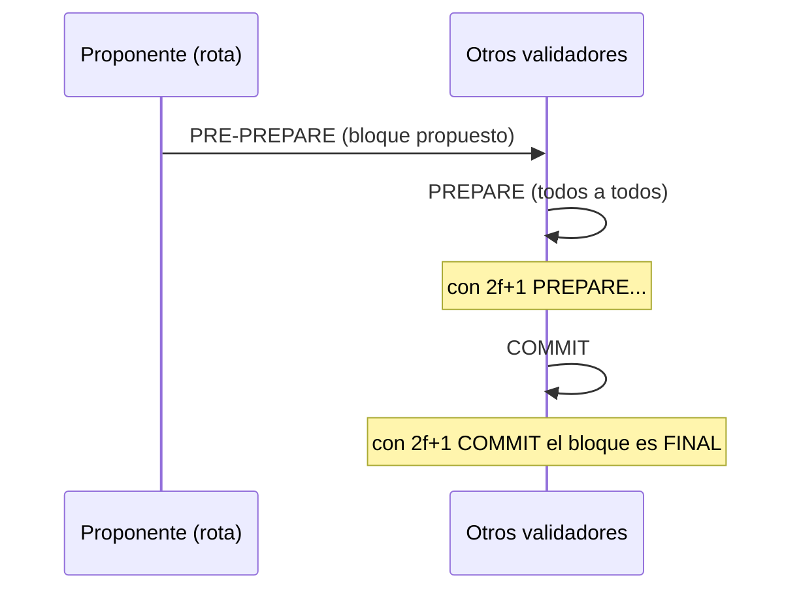

# 01 · Consenso: cómo se ponen de acuerdo los nodos

> Nota: "PoF" no es un mecanismo estándar; lo habitual es **PoW** (Proof of Work). Aquí se comparan los que importan.

| Mecanismo | Quién produce bloques | Tolerancia | Finalidad | Uso típico | En Besu |
|---|---|---|---|---|---|
| **PoW** (Ethash) | Quien resuelve un puzzle de hash (minería) | Atacante con >50 % del cómputo | Probabilística (esperas N bloques) | Bitcoin, Ethereum antiguo | Obsoleto, solo redes legadas |
| **PoS** | Validadores que apuestan (stake) | Depende del protocolo (~1/3 deshonesto) | Por épocas (~13 min en Ethereum) | Ethereum mainnet | Solo para mainnet/redes públicas |
| **PoA – Clique** | Firmantes autorizados, por turnos | Solo fallos por caída; **no** bizantino | Probabilística | Testnets, redes privadas simples | `clique` |
| **IBFT 2.0** | Validadores; rondas con votos | Bizantina: `f = ⌊(n-1)/3⌋` | **Inmediata** | Consorcio | `ibft2` |
| **QBFT** | Igual que IBFT2, protocolo formalizado, interoperable (Quorum/GoQuorum, Besu) | `f = ⌊(n-1)/3⌋` | **Inmediata** | **Consorcio — recomendado** | `qbft` |

## Fallo bizantino
Un nodo "bizantino" puede caerse, mentir o mandar mensajes distintos a cada par. Con `n` validadores se toleran `f = ⌊(n-1)/3⌋` y el quórum es `⌈2n/3⌉` (aquí **n=4 → f=1, quórum 3**). Con 3 validadores no toleras ni uno malicioso con comodidad; con 4 sí uno.

## Cómo funciona una ronda QBFT (simplificado)

Si el proponente falla, vence un temporizador (`requesttimeoutseconds`) y se hace **ROUND-CHANGE** con otro proponente. Los temporizadores crecen exponencialmente: por eso, tras perder quórum, la red tardó **~3 minutos** en retomar al reiniciar los nodos (lo viste en el laboratorio).

## Parámetros del genesis (`network/qbftConfigFile.json`)
- `blockperiodseconds: 2` → un bloque cada 2 s (si no hay txs, igual se producen bloques vacíos).
- `epochlength: 30000` → cada cuántos bloques se reinician los votos de validadores.
- `requesttimeoutseconds: 4` → timeout base de ronda.
- `zeroBaseFee: true` → gas gratis.

## ¿Por qué QBFT en un consorcio?
Las organizaciones se conocen (permisionado), no se quiere quemar energía (PoW) ni exponerse al capital de terceros (PoS), y se necesita **finalidad inmediata** para auditoría. Contra: escalabilidad limitada (comunicación O(n²)), práctico hasta ~20-30 validadores.

## Para probar IBFT2 o Clique
- IBFT2: `.\taller.ps1 reset; .\taller.ps1 up -Consensus ibft2` (usa `ibft2ConfigFile.json`; las llamadas son `ibft_*`).
- Clique: no tiene generador. Hay que armar `extraData` (RLP con los firmantes) y `"clique": {"period":2,"epoch":30000}` en el genesis a mano; ver la documentación de Besu "Create a private network using Clique". Es un buen laboratorio opcional.
