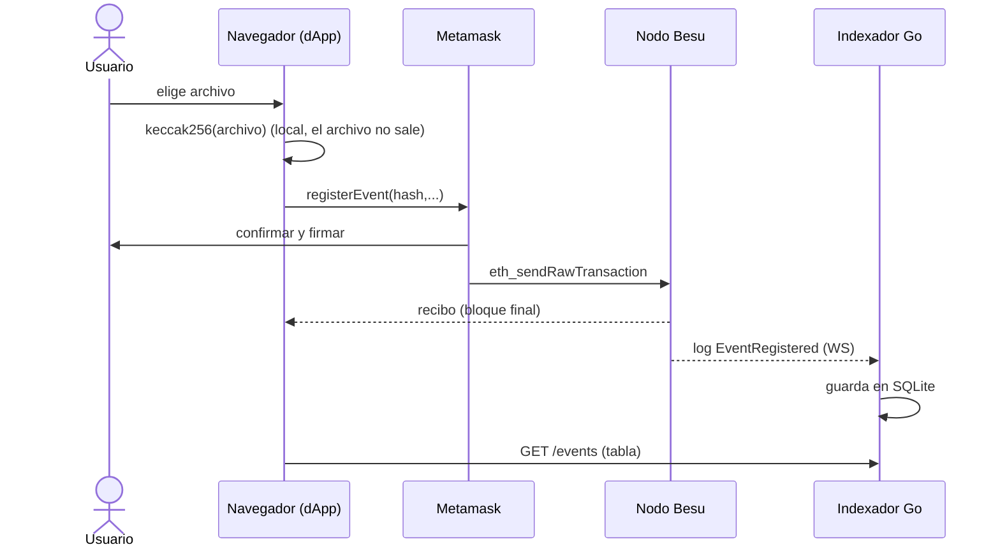

# 08 · La dApp (http://localhost:3000)

Front estático (`dapp/index.html`, `dapp/app.js`) con **ethers v6**. Sin framework ni backend propio.

## Flujo de punta a punta

## Recorrido
1. **Conectar**: agrega la red 20261 y pide cuentas.
2. **Registrar archivo**: hash en el navegador → tx firmada por ti.
3. **Verificar archivo**: lectura directa al RPC (`verify`), sin firmar ni pagar. Prueba con un archivo modificado: "NO existe".
4. **Firmar mensaje** (`personal_sign`) y verificarlo en el cliente y con el endpoint `/verify` del KMS Go: dos implementaciones, misma dirección.
5. **Tabla de eventos** desde el indexador; el botón "vía backend + KMS" muestra el otro camino (firma de servidor).

## Conceptos
- **Lectura on-chain** (`verify`) = verdad, pero limitada a consultas por clave.
- **Lectura indexada** (`/events`) = rápida y flexible, derivada de la cadena.
- La dApp **no tiene secretos**: las llaves quedan en Metamask. Esa es la diferencia clave con una web tradicional.
- Si el indexador está caído, la dApp sigue funcionando para registrar y verificar.
