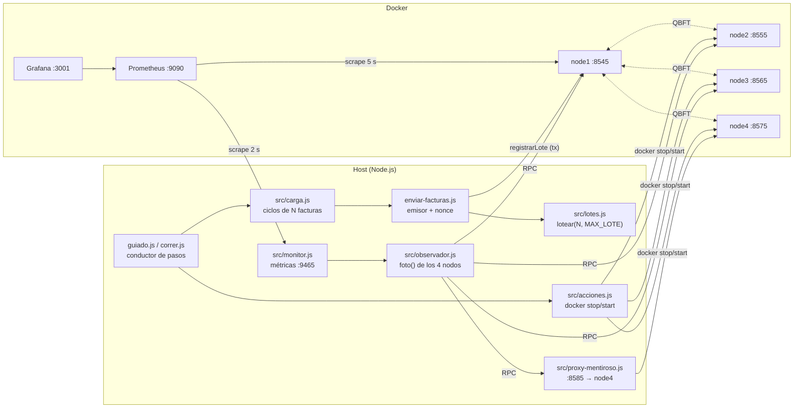

# E2 · Arquitectura del código

[← Volver al README de E2](../README.md)

## Visión general



- **Las transacciones entran siempre por node1.** Por eso node1 nunca se detiene: es el punto de entrada del emisor y la referencia de altura.
- **El observador nunca habla directo con node4**: lo hace a través del proxy. Así, cuando el proxy "miente", lo que se ve es exactamente lo que vería un cliente que confía solo en node4.
- **Las métricas viven en el host** (puerto 9465) y Prometheus las lee por `host.docker.internal`.

## Flujo de un paso

1. `guiado.js` publica la fase (`e2_fase`), imprime qué va a pasar y qué mirar en Grafana.
2. Ejecuta la acción: `proxy.mentir(true)`, `tumbar("node3")`, `carga.iniciar()`…
3. Mientras espera, imprime cada 3 s una línea de estado: `monitor.linea()` (nodos y altura) y `carga.linea()` (facturas y lotes).
4. Mide el resultado (detección, lotes confirmados, altura antes/después) y lo guarda en `ctx.res`.
5. Al final, `cerrarExperimento()` decide el veredicto y escribe `resultados/guiado.json`.

`correr.js` hace lo mismo sin menú ni monitor: envía ráfagas con espera y toma fotos puntuales.

## Módulo por módulo

### `guiado.js` — terminal interactiva
- `PASOS`: arreglo de `{ titulo, que, mirar, ejecutar() }`. El paso 2 usa getters para `que`/`mirar` porque el texto depende de la configuración de la carga.
- `ctx`: estado compartido de la sesión (`proxy`, `monitor`, `emisor`, `carga`, `res`, y datos entre pasos como `base` o `confirmadosAlCaer`).
- `esperar(seg)`: duerme mostrando estado; es lo que da ritmo al video.
- `modoGuiado`, `autopiloto`, `manual`: las tres formas de recorrer los pasos.
- `salir()`: restaura todo y se engancha a `SIGINT` (Ctrl+C).
- Opciones de línea de comandos: `--facturas`, `--cada`, `--pausa`, `--autopiloto` (las pasa `e2.ps1`).

### `correr.js` — conductor automático
- Fase 0: lote de referencia de 2 facturas y comparación del bloque en los 4 nodos.
- Fase 1: activa la mentira, mide cuánto tarda `foto()` en marcar a node4 como divergente, lee `huellaDe` en cada nodo y envía **una ráfaga de N facturas** que debe confirmarse completa.
- Fase 2: detiene node4 (envía una ráfaga con 3 nodos), detiene node3 (envía otra ráfaga sin esperar) y comprueba que en 20 s no avanza; reinicia ambos y mide hasta que **todos los lotes colgados** tienen recibo.
- Escribe `resultados/resumen.json`.

### `enviar-facturas.js` — el emisor
`crearEmisor()` devuelve un objeto con:

| Miembro | Para qué |
|---|---|
| `maxLote` | Tope de ítems por tx leído del contrato (`MAX_LOTE()`); 100 si el ABI no lo trae |
| `enviar(porLote)` | Un único lote (≤ `maxLote`). Lo usan las líneas base |
| `enviarFacturas(total, { esperar })` | Genera `total` facturas, las lotea y manda cada lote con nonce consecutivo. Devuelve `{ facturas, lotes: [{ facturas, tx, recibo }], errores, ms }` |
| `proveedor` | `JsonRpcProvider` hacia node1, para pedir recibos |
| `dep` | Contenido de `deployments/e1.json` (dirección, ABI, chainId) |

Detalles que importan:
- **Nonce propio.** Se lee una vez (`getTransactionCount(…, "pending")`) y se incrementa en memoria; así se pueden enviar varios lotes sin esperar bloque entre ellos. Si un envío falla, se vuelve a leer del nodo para no dejar huecos.
- **Ids que no se repiten.** Cada factura usa un número correlativo cuya base es `Date.now()` en ms. Como la carga consume menos de un id por milisegundo, una corrida nueva nunca reutiliza ids de otra (si lo hiciera con otra huella, el contrato revertiría con `HuellaDistinta`).
- **Generador de E1.** `generarFactura()` de `experimentos/e1-integridad/src/generador.js` arma una factura sintética y su `item` (`facturaId`, `huella`, `cuenta`, `periodo`, `wh`, `cop`), que es lo que se ancla.

### `src/lotes.js`
`lotear(lista, tam)` parte un arreglo en trozos de hasta `tam` conservando el orden; `lotesPara(total, tam)` = `ceil(total / tam)`. Es puro y tiene pruebas en `test/lotes.test.js`.

### `src/carga.js` — carga constante
Clase `Carga`. Ver [Carga de facturas](carga.md) para el detalle. En resumen: `iniciar()` lanza un ciclo inmediato y luego uno cada `cadaMs`; `revisar()` (cada 1 s) busca en paralelo los recibos de los lotes pendientes; `publicar()` fija las métricas; `resumen()` y `linea()` alimentan la terminal y el JSON.

### `src/observador.js` — quién dice la verdad
`foto(urls, extras)`:
1. Pide `eth_blockNumber` a cada nodo. El que no responde queda **caído**.
2. Toma la altura común (la mínima entre los vivos) y, además, las alturas de `extras` (bloques antiguos: una reescritura de historia no toca solo el último bloque).
3. Pide el hash de esos bloques a cada nodo y forma una "firma" por nodo.
4. La firma que repite **más de la mitad** de los que respondieron es la verdad del consorcio. Quien coincide es **honesto**; quien no, **divergente**. Si nadie tiene mayoría, todos quedan divergentes.

Ejecutado solo (`node src/observador.js`) imprime una línea por segundo.

### `src/monitor.js` — métricas
`Monitor` llama a `foto()` cada 500 ms, clasifica cada nodo con `clasificar()` (0 ok, 1 DIVERGE, 2 CAÍDO; función pura con pruebas en `test/monitor.test.js`) y declara la red **detenida** si pasan más de 8 s sin bloque nuevo (con bloques de 2 s, eso ya no es un retraso). Publica en `:9465/metrics` con la clase `Metricas` de E1.

### `src/proxy-mentiroso.js` — el nodo que miente
Servidor HTTP en `:8585` que reenvía todo a node4 (`:8575`). Con `mentir(true)`:
- en `eth_getBlockBy*` reemplaza `hash` y `stateRoot` por un SHA-256 derivado, y
- en `eth_call` que devuelve 32 bytes (como `huellaDe`) responde ceros.

No toca el disco de node4 ni su voto en QBFT: simula "un nodo cuya copia del libro dice otra cosa".

### `src/acciones.js`
`tumbar(nodo)` / `levantar(nodo)` (`docker stop/start`, solo node2–node4), `restaurarNodos()`, `altura()`, `esperarBloque()` y `verdadPorNodo()` (lee `huellaDe(facturaId)` en cada nodo, node4 vía proxy).

### `e2.ps1`
Envoltorio en PowerShell: valida requisitos y traduce `-Facturas`, `-Cada`, `-Pausa`, `-SinLimite`, `-Ciclos` a los flags de los scripts de Node. Ver [Operación](operacion.md).

## El contrato

`contracts-hardhat/contracts/RegistroFacturasMinimo.sol` (el mismo de E1):
- `registrarLote(Item[] items)`: solo el `registrador`; rechaza lotes vacíos o de más de `MAX_LOTE = 100` (`LoteInvalido`); por cada ítem guarda la huella y emite `FacturaAnclada`. Si la factura ya tenía esa huella la omite; si tenía otra, revierte (`HuellaDistinta`).
- `huellaDe(facturaId)`: la huella anclada. Es lo que se le pregunta a cada nodo en el paso 3.

## Pruebas

```powershell
.\experimentos\e2-manipulacion\e2.ps1 pruebas
```

| Archivo | Cubre |
|---|---|
| `test/monitor.test.js` | `clasificar()`: 4 de acuerdo, 1 divergente, caídos, sin mayoría |
| `test/lotes.test.js` | `lotear()` y `lotesPara()`: 500 → 5, 1000 → 10, resto, orden, vacío, tamaño inválido |

Lo que necesita la red (detección, quórum, recuperación) se valida con `correr.js` y `guiado.js`, no con pruebas unitarias.
